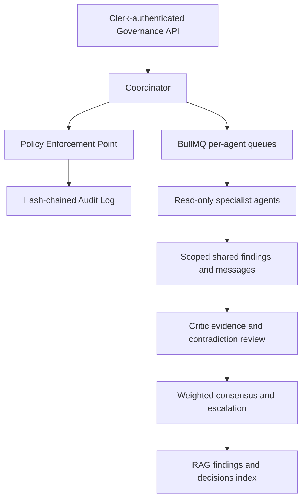

📦 RepoLens Backend

Transform any GitHub repository into structured, queryable intelligence.

RepoLens Backend is a modular, scalable API service that performs repository ingestion, structural parsing, dependency graph construction, and AI-powered querying using a Retrieval-Augmented Generation (RAG) pipeline.

Built with Node.js + Express + MongoDB + Redis, it transforms unstructured GitHub repositories into structured knowledge systems.

🚀 Overview

RepoLens Backend is responsible for:

Repository URL intake

Secure Git cloning

Recursive file traversal

Language detection

AST parsing (JS/TS)

Function & import extraction

Dependency graph construction

Dead code detection

Entry point detection

Cycle detection (SCC)

AI query gateway

Clean REST API exposure

Security & lifecycle management

🏗 Architecture

The backend follows a modular, layered architecture:

Client (Frontend)
        ↓
API Layer (Express)
        ↓
Repository Ingestion Service
        ↓
Scanner & AST Parsing Engine
        ↓
Dependency Graph Builder
        ↓
AI Query Gateway (RAG Bridge)
        ↓
External RAG Service
📂 Project Structure
src/
 ├── app.ts
 ├── server.ts
 ├── config/
 ├── controllers/
 ├── services/
 ├── models/
 ├── routes/
 ├── middleware/
 ├── utils/
 ├── workers/
🧠 Core Modules
1️⃣ Repository Ingestion

Strict GitHub URL validation

Duplicate submission protection

Safe shallow clone (--depth 1)

Clone timeout enforcement

Repository size restriction

Temporary directory management

Cleanup on failure

Lifecycle status tracking

Processing States
RECEIVED
CLONING
SCANNING
PARSING
GRAPHING
READY
FAILED
2️⃣ File Scanner

Recursive directory traversal

Ignore:

node_modules

.git

dist

build

coverage

benchmarks

test directories

File size filtering

Language detection

Metadata extraction

Stored in:

FileModel

3️⃣ AST Parsing Engine

Using:

@babel/parser

@babel/traverse

Extracts:

Function declarations

Arrow functions

Function expressions

Class methods

Imports

Call expressions

Stored in:

FunctionModel

ImportModel

CallModel

4️⃣ Dependency Graph Builder
Function-Level Graph

Node → Function
Edge → Call relationship

Features:

Entry point detection

Dead function detection

Depth calculation

Strongly Connected Components (Tarjan)

Deterministic ordering

Duplicate edge prevention

File-Level Graph

Node → File
Edge → Import relationship

Frontend-ready JSON output.

5️⃣ Structure Endpoint

Returns full repository metadata:

files
functions
imports

Used for:

Frontend visualization

AI context building

Repository introspection

6️⃣ AI Query Layer

RepoLens acts as a gateway to a RAG-based AI service.

Flow:

POST /ask
    ↓
Validate repo + question
    ↓
Ensure status = READY
    ↓
Forward to RAG service
    ↓
Return structured answer
🔌 API Endpoints
Analyze Repository
POST /api/v1/analyze

Body:

{
  "repo_url": "https://github.com/user/repo"
}

Response:

{
  "success": true,
  "data": {
    "repo_id": "...",
    "status": "RECEIVED"
  }
}
Get Function Graph
GET /api/v1/:repoId/graph

Returns:

nodes
edges
node_count
edge_count
Get File Graph
GET /api/v1/:repoId/file-graph
Get Repository Structure
GET /api/v1/:repoId/structure
Ask AI
POST /api/v1/ask

Body:

{
  "repo_id": "...",
  "question": "How does authentication work?"
}
🔐 Security Features

Helmet middleware

Global rate limiting

Analyze-specific rate limiter

Strict GitHub HTTPS validation

Length limits on inputs

spawn() instead of exec()

Clone timeout protection

Error sanitization

Centralized error handling

🗄 Database Models

Repository

File

Function

Import

Call

MongoDB is used for flexible document storage.

⚙️ Environment Variables

Create .env file:

PORT=5000
MONGO_URI=your_mongodb_uri
REDIS_URL=your_redis_url
CORS_ORIGINS=http://localhost:5173,https://repolens-sage.vercel.app
RAG_SERVICE_URL=http://localhost:8000/ask
NODE_ENV=development
▶️ Running Locally
1️⃣ Install Dependencies
npm install
2️⃣ Start Server
npm run dev
3️⃣ Start Worker

If separate worker file exists:

npm run worker
🧪 Testing Flow

POST /analyze

Wait until status = READY

GET /graph

GET /structure

POST /ask

📊 Performance Characteristics

Graph build complexity: O(N + E)

Max file count default: 5000

Shallow clone improves performance

Bulk database writes for efficiency

🧭 Production Considerations

Not included in MVP:

Clerk-authenticated operator identity is supported; governance administration uses the configured Clerk user-ID allowlist.

Extended organization-wide RBAC beyond the governance admin allowlist

Billing

GitHub OAuth

Caching layer

Vector DB (handled by RAG service)

CI/CD automation

🧩 Future Enhancements

Vector embeddings inside backend

Chunked context generation

Streaming AI responses

Graph pagination

Large repo optimization

Caching graph results

👥 Team Responsibilities
Abhay — Core Architecture & Infrastructure

Express setup

Ingestion pipeline

Security

Lifecycle management

Anand — File Scanner & AST Engine

File traversal

Metadata extraction

Parsing

Ashutosh — Dependency Graph & Data Layer

Function graph

File graph

Graph serialization

Prakhar — API & AI Integration

Route wiring

AI bridge

Response formatting

🏆 What Makes RepoLens Unique

Static analysis + AI integration

Graph-based code understanding

Dead code detection

Entry point discovery

RAG-powered semantic querying

Production-style backend architecture

📜 License

MIT License

🎯 Final Note

RepoLens Backend is designed not just as a project, but as a scalable foundation for a full-stack intelligent code analysis platform

## Multi-Agent Governance

Repository analysis can run as a governed multi-agent job. The coordinator only accepts repositories in `READY`, assigns deterministic specialist tasks, reuses matching completed tasks, and tracks each run in MongoDB. Dependency, dead-code, structure, security, quality, and Q&A agents receive read-only tools; the Critic checks evidence and contradictions before weighted consensus is stored.

Every delegation, tool call, shared-memory message, and finding output passes through the Policy Enforcement Point. Active, versioned JSON policies control tool permissions, delegation, evidence requirements, high-risk review, budget rules, scope checks, injection stripping, secret redaction, and static-only analysis. Decisions are recorded in a SHA-256 chained audit log. Finalized findings and decisions are indexed in the RAG service; each job reports `ragIndexingStatus` as `PENDING`, `INDEXED`, or `FAILED` so indexing outages remain visible and retryable.

Governance endpoints are mounted under `/api/v1/governance` and require the existing Clerk bearer token:

| Method | Path | Purpose |
| --- | --- | --- |
| `POST` | `/jobs` | Start an analysis (`repo_id`, optional `analysis_types`, optional Q&A `question`) |
| `GET` | `/jobs/:jobId` | Job status, tasks, and agent progress |
| `GET` | `/jobs/:jobId/findings` | Findings; optional `agent` and `category` filters |
| `GET` | `/jobs/:jobId/decision` | Consensus decisions, supporting findings, and dissent |
| `GET` | `/agents` | Active agent roles, capabilities, and trust weights |
| `GET` / `PUT` | `/policies`, `/policies/:id` | Read active policies or create a new policy version (admin only) |
| `GET` | `/violations?jobId=` | Denied, redacted, and escalated policy events |
| `GET` | `/audit?jobId=` | Caller-owned audit entries |
| `GET` | `/audit/verify` | Verify the append-only audit hash chain |
| `POST` | `/decisions/:id/approve` | Approve or reject an escalated decision (`{ "approved": boolean }`) |

Set `GOVERNANCE_ADMIN_USER_IDS` to a comma-separated allowlist of Clerk user IDs permitted to update policies. Job and audit reads are limited to repositories owned by the authenticated caller. `npm test` builds the TypeScript backend and runs the governance unit suite.

Human approval also provides a small trust-weight update: findings that supported an approved consensus gain 0.05 weight and dissenting agents lose 0.05, bounded to the configured 0.5–1.5 range. Repeated processing of the same approved decision is idempotent.
